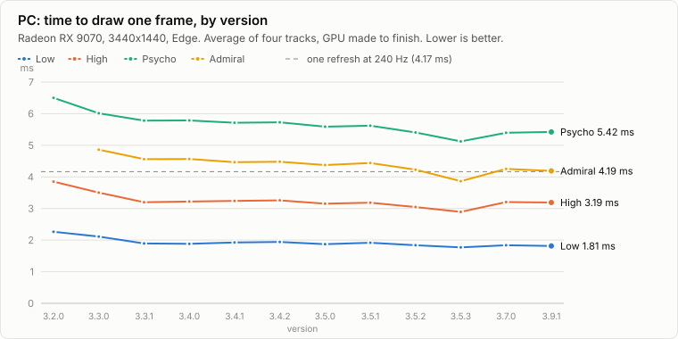
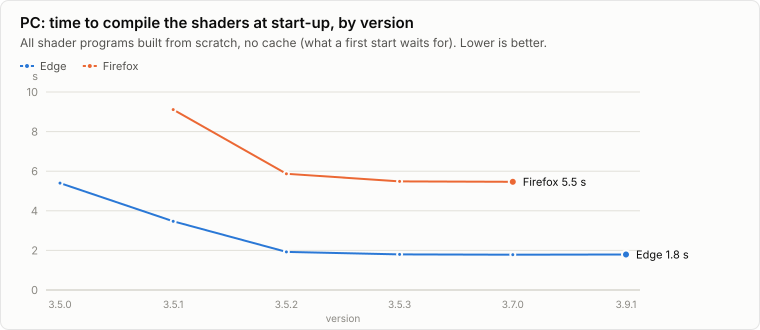
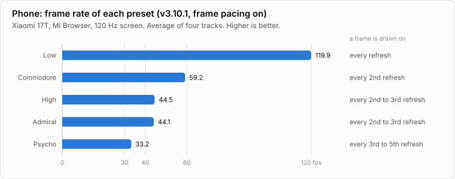

# Performance history

How Crestline's speed changed from v3.1.0 on, from the benchmark reports sent in during development.

- **What is measured.** The built-in benchmark runs the same four tracks (Forest, Mountains, Night, Futuristic)
  at fixed quality presets with a bot driving, 5 seconds each. The figures here are averages over the four tracks.
- **fps** is what the screen actually got, so it can never be above the screen's refresh rate.
- **Frame cost** is the time to draw one whole frame with the graphics chip made to finish, without waiting for
  the screen. It shows how much room is left when fps is pinned at the refresh rate.
- **A stall** is a frame that took more than twice the median and more than 25 ms.
- Every figure is one run on one device. Differences of a few percent between neighbouring versions are noise:
  the Psycho preset on the PC, for example, moved between 202 and 220 fps from run to run while its frame cost
  hardly changed.

The numbers behind every chart and table are in [`perf/benchmarks.json`](perf/benchmarks.json); the charts are
drawn from it by [`tools/perfcharts.py`](../tools/perfcharts.py).

## PC: time to draw a frame

Radeon RX 9070, Ryzen 9 5950X, 3440x1440 at 240 Hz, Edge.

<picture>
  <source media="(prefers-color-scheme: dark)" srcset="perf/pc-frame-cost-dark.svg">
  
</picture>

<!-- table:pc-edge -->
| Version | Low | High | Psycho | Admiral | Psycho fps | Admiral fps |
|---|---|---|---|---|---|---|
| 3.2.0 | 2.26 ms | 3.85 ms | 6.50 ms | – | 195.0 | – |
| 3.3.0 | 2.11 ms | 3.50 ms | 6.01 ms | 4.86 ms | 207.0 | 227.1 |
| 3.3.1 | 1.90 ms | 3.20 ms | 5.78 ms | 4.56 ms | 219.4 | 228.3 |
| 3.4.0 | 1.88 ms | 3.22 ms | 5.79 ms | 4.57 ms | 212.0 | 228.2 |
| 3.4.1 | 1.92 ms | 3.24 ms | 5.71 ms | 4.46 ms | 212.5 | 233.0 |
| 3.4.2 | 1.94 ms | 3.26 ms | 5.73 ms | 4.48 ms | 210.8 | 234.0 |
| 3.5.0 | 1.87 ms | 3.15 ms | 5.59 ms | 4.38 ms | 213.6 | 236.1 |
| 3.5.1 | 1.92 ms | 3.19 ms | 5.62 ms | 4.44 ms | 202.2 | 235.6 |
| 3.5.2 | 1.84 ms | 3.04 ms | 5.40 ms | 4.23 ms | 212.9 | 237.8 |
| 3.5.3 | 1.77 ms | 2.89 ms | 5.12 ms | 3.87 ms | 219.9 | 239.8 |
| 3.7.0 | 1.84 ms | 3.20 ms | 5.40 ms | 4.25 ms | 218.6 | 239.7 |
| 3.9.1 | 1.81 ms | 3.19 ms | 5.42 ms | 4.19 ms | 213.8 | 239.6 |
<!-- /table -->

Low and High measured 239.8 fps in every one of these runs. Admiral is the Psycho preset without anti-aliasing
and with a slightly shorter view; before v3.4.0 it was not a preset yet and ran as custom settings with the same
values. The Commodore preset arrived in v3.9.0: 2.67 ms and 239.8 fps in v3.9.1.

What moved the lines:

- **v3.3.0, v3.3.1:** the ground is shaded only where it is seen, and the far backdrop is drawn after the terrain.
- **v3.4.0 to v3.4.2:** a lighter sun-shadow pass; the city towers cast shadows as plain hulls and get a distance model.
- **v3.5.2, v3.5.3:** a lighter car model from 80 m, and one lighting calculation per car pixel instead of one per material.
- **v3.7.0:** six picture improvements (model shading, cloud shadows, haze, terrain texture, smoother detail
  change-over, real sky reflections). They cost 0.3 to 0.4 ms a frame here.
- **v3.8.0 to v3.9.1:** phone work only; nothing measurable changed on the PC.

## PC: shader compilation at start-up

<picture>
  <source media="(prefers-color-scheme: dark)" srcset="perf/shader-compile-dark.svg">
  
</picture>

A first start has to wait for the graphics driver to compile every shader program. The benchmark has timed that
since v3.5.0, building each program from scratch so that no cache can answer.

<!-- table:compile -->
| Version | Edge | Firefox |
|---|---|---|
| 3.5.0 | 5.4 s | – |
| 3.5.1 | 3.5 s | 9.1 s |
| 3.5.2 | 1.9 s | 5.9 s |
| 3.5.3 | 1.8 s | 5.5 s |
| 3.7.0 | 1.8 s | 5.5 s |
| 3.9.1 | 1.8 s | – |
| 3.9.3 | – | 5.5 s |
| 3.10.0 | – | 5.7 s |
| 3.10.5 | – | 5.5 s |
<!-- /table -->

The gain came in v3.5.1 and v3.5.2 from rewriting the terrain noise so that the compiler sees far fewer copies of
the same code. Firefox compiles one program at a time, which is why it stays about three times slower than Edge.
Start-up as a whole (page opened to third frame) went from 6.5 s to 2.1 s in Edge and from 10.7 s to 5.2 s in
Firefox, but that figure also depends on what the browser has cached, so it jumps around between runs.

The v3.10.0 and v3.10.5 figures include the three SMAA programs (26 and 25 programs in all, against 22 in
v3.9.3); those three take about 0.14 s.

## What the SMAA option costs

SMAA is a second kind of anti-aliasing, added in v3.10.0 as an option. It was off in every preset until v3.10.2,
which turns it on in Commodore; the measurements below were made before that, with it switched on by hand.
Measured on the PC in Firefox (v3.10.0), as the Admiral preset with SMAA on beside the stock Admiral preset in the same run,
two runs:

<!-- table:smaa-pc -->
| Track | Admiral | with SMAA | difference | the SMAA stage alone | fps, pacing off | fps, pacing on |
|---|---|---|---|---|---|---|
| Forest | 5.05 ms | 5.28 ms | +0.23 ms | 0.32 ms | 236.0 → 226.8 | 239.0 → 129.0 |
| Mountains | 3.95 ms | 4.20 ms | +0.25 ms | 0.25 ms | 239.8 → 239.8 | 239.8 → 239.8 |
| Night | 3.78 ms | 4.00 ms | +0.22 ms | 0.21 ms | 239.8 → 239.8 | 239.8 → 239.6 |
| Futuristic | 4.67 ms | 4.79 ms | +0.12 ms | 0.31 ms | 239.8 → 239.8 | 239.2 → 236.4 |
| **Average** | 4.36 ms | 4.57 ms | +0.21 ms | 0.27 ms | | |
<!-- /table -->

About 0.2 to 0.3 ms a frame at 3440x1440, by either way of measuring it. Firefox has no GPU timers, so every
time here was taken by making the graphics card finish; single figures move by a tenth of a millisecond from run
to run (Futuristic's difference was -0.11 ms in one run and +0.35 ms in the other).

What it does to the frame rate depends on how much room the preset had. Mountains and Night keep 240 fps
either way; Futuristic keeps it without frame pacing and gave 236 with it. Forest is where Admiral was already
at its limit, and there SMAA takes it from 236 to 227 fps; with frame pacing on, the pacer then decides that
too many frames are late and settles on every 2nd refresh, 120 fps for most of the run (the benchmark holds
whatever rhythm the warm-up found; in a race the pacer tries the faster rhythm again after a while).

Its three shader programs took 0.14 s to compile together (0.10 s of it the weights pass), and only when the
option is on.

### On the phone

The same comparison on the phone (Xiaomi 17T, Mi Browser, v3.10.1, frame pacing on), with the Commodore preset,
one run:

<!-- table:smaa-phone -->
| Track | Commodore | with SMAA | difference | fps | 1 % low | stalls in 5 s |
|---|---|---|---|---|---|---|
| Forest | 8.80 ms | 9.62 ms | +0.82 ms | 58.2 → 57.5 | 32.7 → 30.0 | 0 → 1 |
| Mountains | 6.49 ms | 7.83 ms | +1.34 ms | 59.8 → 59.9 | 40.0 → 45.0 | 0 → 0 |
| Night | 5.07 ms | 7.19 ms | +2.12 ms | 59.9 → 60.0 | 44.9 → 51.3 | 0 → 0 |
| Futuristic | 8.90 ms | 8.32 ms | -0.58 ms | 59.0 → 58.6 | 32.8 → 30.0 | 0 → 1 |
| **Average** | 7.31 ms | 8.24 ms | +0.93 ms | 59.2 → 59.0 | | |
<!-- /table -->

With SMAA on, Commodore still drew on every 2nd refresh on all four tracks: 59.0 fps against 59.2. Two frames
took 33 ms in its 20 seconds, none without it.

The frame cost read 0.9 ms higher on average, but that figure is weak. On this phone the same preset moves by a
millisecond or more between runs (stock Commodore read 8.7 ms in v3.9.3 and 7.3 ms here, with nothing changed in
how it draws), and the per-track differences run from -0.6 to +2.1 ms. One run says "about a millisecond, and
60 fps holds"; it does not say more.

Its three shader programs compiled in 0.05 s on the phone.

## Phone: stalls, and frame pacing

Xiaomi 17T (Mali-G720 MC8), Mi Browser, 120 Hz screen.

On this phone every preset too heavy to finish a frame within one screen refresh stalled several times a second:
most frames quick, then one of 75 to 150 ms. Frame pacing (v3.8.0 to v3.9.1, an option in Settings) draws on every
2nd, 3rd or 4th refresh at a steady rhythm instead.

<picture>
  <source media="(prefers-color-scheme: dark)" srcset="perf/phone-pacing-dark.svg">
  
</picture>

It took six versions to get right, and the reports show each attempt, failures included:

<!-- table:phone-history -->
| Version | Pacing | Low fps | High fps | Admiral fps | Psycho fps | High stalls | Admiral stalls | Psycho stalls |
|---|---|---|---|---|---|---|---|---|
| 3.1.0 | off | 119.1 | 53.5 | – | 33.2 | 166 | – | 97 |
| 3.5.4 | off | 118.8 | 52.9 | 55.5 | 39.3 | 138 | 135 | 99 |
| 3.7.1 | off | 118.1 | 43.3 | 47.4 | 33.4 | 150 | 158 | 72 |
| 3.8.0 | on | 21.2 | 18.7 | 20.4 | 17.6 | 0 | 0 | 0 |
| 3.8.1 | on | 71.4 | 36.8 | 36.5 | 26.9 | 8 | 2 | 0 |
| 3.8.2 | on | 119.7 | 40.0 | 45.6 | 31.9 | 13 | 32 | 30 |
| 3.8.3 | on | 117.2 | 39.7 | 20.0 | 24.9 | 3 | 0 | 3 |
| 3.8.4 | on | 119.1 | 40.0 | 39.6 | 29.2 | 3 | 0 | 8 |
| 3.9.0 | on | 119.5 | 38.3 | – | 24.6 | 4 | – | 3 |
| 3.9.1 | on | 119.5 | 39.7 | 44.4 | 31.2 | 1 | 2 | 0 |
| 3.9.3 | on | 119.6 | 46.5 | 44.8 | 35.0 | 0 | 1 | 2 |
| 3.10.1 | on | 119.9 | 44.5 | 44.1 | 33.2 | 2 | 3 | 1 |
<!-- /table -->

Stalls are totals over the four tracks, 20 seconds in all.

- **v3.8.0** waited for the graphics chip to report each frame finished. On this phone that report comes 30 to
  50 ms late whatever the load, and everything fell to about 20 fps.
- **v3.8.1** watched the screen's own refresh ticks instead, but slowed down during loading and recovered too slowly.
- **v3.8.3** read a browser habit (holding the page back while a frame is unfinished) as overload without end and
  drove Admiral to the slowest rhythm it has.
- **From v3.8.4** each frame is judged against the rhythm it is meant to keep.
- **v3.9.3** is not a pacing change: it is the frame-order fix described under "What got slower, and why".
- **v3.10.1** draws a frame exactly as v3.9.3 does unless the SMAA option is on. Its row differs from the one
  above only by what this phone does from one run to the next: a stall or two, 1 or 2 fps.

Three things to know when reading the table:

- Pacing trades frames for evenness. Between v3.7.1 without it and v3.9.1 with it, High gave up 4 fps of average
  (43.3 to 39.7), Admiral 3, Psycho 2. With the v3.9.3 fix on top, High and Psycho are faster than they were
  before pacing (46.5 and 35.0 fps) and Admiral is 3 fps slower (44.8).
- Not every stall is gone: the v3.9.3 run had three (Admiral one, Psycho two, the longest 133 ms) and the
  v3.10.1 run six (High two, Admiral three, Psycho one of 142 ms).
- Since v3.9.1 the benchmark, with pacing on, starts measuring once the rhythm has settled. The second or two of
  searching at the start of a race is therefore not in the rows from v3.9.1 on; v3.8.2 and v3.8.4, measured the
  old way, show what it adds.

## Phone: the presets today

<picture>
  <source media="(prefers-color-scheme: dark)" srcset="perf/phone-presets-dark.svg">
  
</picture>

<!-- table:phone-presets -->
| Preset | fps | Lowest 1 % low | Frame cost | Stalls in 20 s | Longest frame |
|---|---|---|---|---|---|
| Low | 119.9 | 89.7 | 5.0 ms | 0 | 25 ms |
| Commodore | 59.2 | 32.7 | 7.3 ms | 0 | 33 ms |
| High | 44.5 | 20.0 | 12.4 ms | 2 | 50 ms |
| Admiral | 44.1 | 17.1 | 12.6 ms | 3 | 58 ms |
| Psycho | 33.2 | 11.4 | 18.8 ms | 1 | 142 ms |
<!-- /table -->

Commodore (new in v3.9.0) keeps sun shadows and ambient occlusion but drops MSAA and renders at 80 %
resolution, the two things this chip pays most for. It is the heaviest preset that holds 60 fps on this phone on
all four tracks; High does on Mountains only, Admiral on Night only.

From v3.10.2 Commodore has SMAA anti-aliasing. The row above is the v3.10.1 run, without it. The same run also
measured Commodore with SMAA switched on by hand, which is what the preset is now: 59.0 fps, 8.2 ms, two stalls
(see "What the SMAA option costs").

## What got slower, and why

The picture improvements of v3.7.0 were close to free on the PC (0.3 to 0.4 ms a frame) but not on the phone.
Without pacing, High went from 11.5 ms and 52.9 fps (v3.5.4) to 14.8 ms and 43.3 fps (v3.7.1), and Psycho from
18.3 to 21.1 ms.

A test in v3.9.2 switched the effects one at a time on the phone (High preset, three interleaved rounds, frame
cost in ms, median with lowest and highest):

| | Forest | Mountains |
|---|---|---|
| As released (v3.7.0 to v3.9.2) | 16.8 (14.3-16.9) | 15.0 (12.7-16.5) |
| Sky picture drawn before the main picture | 12.3 (11.3-13.4) | 9.4 (8.7-11.2) |
| No sky picture at all | 14.2 (13.2-15.1) | 9.8 (9.5-10.2) |

The cars reflect a small picture of the sky, and v3.7.0 drew it in the middle of the main picture. A phone's
graphics chip draws in tiles and has to write the whole main picture out to memory and read it back when a frame
leaves it half-way, anti-aliasing samples included. That detour, not the sky picture itself, cost 4.5 to 5.6 ms a
frame. Since v3.9.3 the sky picture is drawn first; the image is the same pixel for pixel.

The other four effects (cloud shadows, haze, terrain texture, model change-over) each came out within the spread
between rounds, about 1.5 ms, so the test could not tell their cost from zero. Commodore, which has no sky
picture, measured the same either way.

The benchmark on v3.9.3 (pacing on) against v3.9.1:

| | fps, v3.9.1 | fps, v3.9.3 | Frame cost, v3.9.1 | Frame cost, v3.9.3 |
|---|---|---|---|---|
| High | 39.7 | 46.5 | 13.8 ms | 10.5 ms |
| Psycho | 31.2 | 35.0 | 22.0 ms | 17.0 ms |
| Admiral | 44.4 | 44.8 | 13.2 ms | 12.2 ms |
| Commodore | 59.0 | 59.8 | 8.4 ms | 8.7 ms |

High and Psycho, the two presets with anti-aliasing, got 3.3 and 5.0 ms of their frame back. High now holds 60 fps
on Mountains and moves between 40 and 60 on the other tracks; at about 11 ms a frame it sits right at the edge of
what this phone can keep up on every 2nd refresh. Admiral and Commodore, without anti-aliasing, hardly moved.

## Other devices

A laptop with integrated graphics (Intel Core 5 120U, Firefox, 60 Hz):

<!-- table:laptop -->
| Version | Low fps | High fps | Psycho fps | Low cost | High cost | Psycho cost |
|---|---|---|---|---|---|---|
| 3.2.0 | 57.5 | 36.8 | 16.1 | 23.4 ms | 34.7 ms | 82.2 ms |
| 3.4.3 | 60.0 | 52.5 | 20.3 | 13.5 ms | 20.6 ms | 56.4 ms |
| 3.5.0 | 60.0 | 53.0 | 20.4 | 13.3 ms | 19.2 ms | 54.3 ms |
<!-- /table -->

An old phone that is not one of the game's own test devices (Xiaomi 23129RN51X: PowerVR Rogue GE8320, 2 GB,
1650x720, a 90 Hz screen). Ultra Low is the preset every phone started on up to v3.10.6 (from v3.10.7 a
phone's first start times a few frames and picks Commodore, Low or Ultra Low):

<!-- table:oldphone -->
| Version | Browser | Pacing | Roadside objects | Ultra Low fps | Low fps | Ultra Low cost | Low cost | Ultra Low JavaScript | Low JavaScript |
|---|---|---|---|---|---|---|---|---|---|
| 3.4.3 | Chrome | off | not checked | 22.3 | 14.5 | 33.8 ms | 58.1 ms | 14.8 ms | 20.9 ms |
| 3.10.2 | Edge | on | missing | 19.7 | 13.1 | 33.2 ms | 56.0 ms | 11.6 ms | 19.0 ms |
| 3.10.5 | Chrome | on | drawn | 18.6 | 11.5 | 46.2 ms | 80.1 ms | 17.1 ms | 23.7 ms |
| 3.10.8 | Chrome | on | drawn | 18.1 | – | 51.5 ms | – | 12.2 ms | – |
<!-- /table -->

What these three rows do and do not say:

- **Up to v3.10.4 this phone drew no roadside objects at all**: no trees, buildings, cones or oncoming traffic.
  Its graphics driver gets one condition in the objects vertex shader wrong, and every object was moved off
  the screen. Found with the scenery test of v3.10.3 and v3.10.4 and fixed in v3.10.5 by writing the condition
  another way; the phone then showed them, and the test counted the same share of the picture as on the
  development machine (29.3 % on Forest, 41.6 % on Futuristic). Whether v3.4.3 showed them was not checked. The
  faulty line is as old as the scenery, so probably not.
- **v3.10.2 and v3.10.5 are not a clean before and after.** The browsers differ, and the JavaScript side was
  slower in the second run: the simulation took 9.9 ms a frame on Ultra Low against 3.7 ms, with the same
  simulation code. Draw calls and instances are the same in both (71 and about 465 a frame on Ultra Low: the
  objects were always sent to the GPU, they just never reached the screen). Why that run was slower is not
  known. So the rise in frame cost is partly the objects now being drawn and partly something else.
- **v3.10.8 has no Low figure** because the benchmark, from that version on, gives up on a preset that comes in
  under 10 fps: Low reached 9.9 fps on Forest (10.3 in v3.10.5), so it and the heavier presets were not run
  again. This phone's Low sits right on that limit; another run may keep it. The simulation read 4.5 ms a
  frame on Forest in this run, against 9.4 ms in v3.10.5: that earlier run was slow for a reason outside the
  game.
- Ultra Low per track in v3.10.5: Forest 19.5 fps, Mountains 22.3, Night 19.4, Futuristic 13.4. Frame pacing put
  a frame on every fourth refresh of the 91 Hz screen, which allows 22.8 fps at best.
- The other presets in v3.10.5: Commodore 3.3 fps, Admiral 2.3, High 1.7, Psycho 1.3. One stage swallows the
  frame in each: the MSAA resolve on High and Psycho (330 to 910 ms a frame), ambient occlusion on Admiral and
  Commodore (170 to 440 ms). SMAA took 16 to 24 ms.

A second weak phone, not identified (4 threads, 4 GB, 2400x1080, Chrome, v3.10.2), lost its graphics context
when the benchmark went from Low to High, so only its first case was measured: Low on Forest, 26.6 fps, frame
cost 28.7 ms, 9.3 ms of it JavaScript.

The PC in Firefox reached the same frame rates as in Edge from v3.5.3 on (Admiral 239.6 fps, Psycho 229.7); in
v3.1.0 it had managed 229.2 fps on High and 162.5 on Psycho. On v3.9.3 it was measured with frame pacing on, which
on this machine only touches Psycho: Low, High and Commodore 239.8 fps, Admiral 239.7, and Psycho 205.7, held
at a flat 120 on Forest. v3.10.0 gave the same picture, without pacing and with it: Low, High and Commodore
239.8 fps, Admiral 238.9 and 239.5, Psycho 228.2 and 206.3. v3.10.5, with pacing: Low, High, Admiral and
Commodore 239.8 fps, Psycho 198.4 (pacing went to every second refresh part of the way through Forest and
Futuristic). That is the first PC run in which Commodore includes SMAA: frame cost 3.09 ms, of which the SMAA
stage 0.08 to 0.22 ms.

Measured once, so no history to show: the main phone in Brave, which ran at 60 Hz (v3.7.1, no pacing: Low
63.3 fps, High 45.2, Psycho 35.4).

## Not measured

- v3.9.3 to v3.10.5 on the PC in Edge (the chart at the top ends at v3.9.1; Firefox was measured, see above).
- v3.10.2 to v3.10.5 on the main phone: its last run is v3.10.1.
- The SMAA option on the laptop, on the PC in Edge (where GPU timers would time the pass directly), and on the
  phone with any preset but Commodore or more than once. Outside its own section the only figures on this
  page that include it are the v3.10.5 Commodore ones (the PC in Firefox, the old phone): every other Commodore
  row was measured before v3.10.2 put SMAA into that preset. To measure it: turn it on in Graphics options and run the benchmark; the report then has a
  row for your settings beside the stock preset, and a stage line "anti-aliasing (SMAA)".
- Frame pacing on the main phone in any browser other than Mi Browser.
- Frame pacing together with dynamic resolution. The benchmark switches dynamic resolution off.
- The laptop on any version after v3.5.0.
