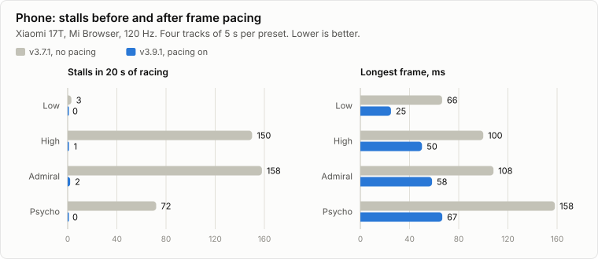

# Performance history

How Crestline's speed changed from v3.1.0 to v3.9.1, from the benchmark reports sent in during development.

- **What is measured.** The built-in benchmark runs the same four tracks (Forest, Mountains, Night, Futuristic)
  at fixed quality presets with a bot driving, 5 seconds each. The figures here are averages over the four tracks.
- **fps** is what the screen actually got, so it can never be above the screen's refresh rate.
- **Frame cost** is the time to draw one whole frame with the graphics chip made to finish, without waiting for
  the screen. It shows how much room is left when fps is pinned at the refresh rate.
- **A stall** is a frame that took more than twice the median and more than 25 ms.
- Every figure is one run on one device. Differences of a few percent between neighbouring versions are noise:
  the Psycho preset on the PC, for example, moved between 202 and 220 fps from run to run while its frame cost
  hardly changed.

The numbers behind every chart and table are in [`perf/benchmarks.json`](perf/benchmarks.json); the charts are
drawn from it by [`tools/perfcharts.py`](../tools/perfcharts.py).

## PC: time to draw a frame

Radeon RX 9070, Ryzen 9 5950X, 3440x1440 at 240 Hz, Edge.

<picture>
  <source media="(prefers-color-scheme: dark)" srcset="perf/pc-frame-cost-dark.svg">
  
</picture>

<!-- table:pc-edge -->
| Version | Low | High | Psycho | Admiral | Psycho fps | Admiral fps |
|---|---|---|---|---|---|---|
| 3.2.0 | 2.26 ms | 3.85 ms | 6.50 ms | – | 195.0 | – |
| 3.3.0 | 2.11 ms | 3.50 ms | 6.01 ms | 4.86 ms | 207.0 | 227.1 |
| 3.3.1 | 1.90 ms | 3.20 ms | 5.78 ms | 4.56 ms | 219.4 | 228.3 |
| 3.4.0 | 1.88 ms | 3.22 ms | 5.79 ms | 4.57 ms | 212.0 | 228.2 |
| 3.4.1 | 1.92 ms | 3.24 ms | 5.71 ms | 4.46 ms | 212.5 | 233.0 |
| 3.4.2 | 1.94 ms | 3.26 ms | 5.73 ms | 4.48 ms | 210.8 | 234.0 |
| 3.5.0 | 1.87 ms | 3.15 ms | 5.59 ms | 4.38 ms | 213.6 | 236.1 |
| 3.5.1 | 1.92 ms | 3.19 ms | 5.62 ms | 4.44 ms | 202.2 | 235.6 |
| 3.5.2 | 1.84 ms | 3.04 ms | 5.40 ms | 4.23 ms | 212.9 | 237.8 |
| 3.5.3 | 1.77 ms | 2.89 ms | 5.12 ms | 3.87 ms | 219.9 | 239.8 |
| 3.7.0 | 1.84 ms | 3.20 ms | 5.40 ms | 4.25 ms | 218.6 | 239.7 |
| 3.9.1 | 1.81 ms | 3.19 ms | 5.42 ms | 4.19 ms | 213.8 | 239.6 |
<!-- /table -->

Low and High measured 239.8 fps in every one of these runs. Admiral is the Psycho preset without anti-aliasing
and with a slightly shorter view; before v3.4.0 it was not a preset yet and ran as custom settings with the same
values. The Commodore preset arrived in v3.9.0: 2.67 ms and 239.8 fps in v3.9.1.

What moved the lines:

- **v3.3.0, v3.3.1:** the ground is shaded only where it is seen, and the far backdrop is drawn after the terrain.
- **v3.4.0 to v3.4.2:** a lighter sun-shadow pass; the city towers cast shadows as plain hulls and get a distance model.
- **v3.5.2, v3.5.3:** a lighter car model from 80 m, and one lighting calculation per car pixel instead of one per material.
- **v3.7.0:** six picture improvements (model shading, cloud shadows, haze, terrain texture, smoother detail
  change-over, real sky reflections). They cost 0.3 to 0.4 ms a frame here.
- **v3.8.0 to v3.9.1:** phone work only; nothing measurable changed on the PC.

## PC: shader compilation at start-up

<picture>
  <source media="(prefers-color-scheme: dark)" srcset="perf/shader-compile-dark.svg">
  
</picture>

A first start has to wait for the graphics driver to compile every shader program. The benchmark has timed that
since v3.5.0, building each program from scratch so that no cache can answer.

<!-- table:compile -->
| Version | Edge | Firefox |
|---|---|---|
| 3.5.0 | 5.4 s | – |
| 3.5.1 | 3.5 s | 9.1 s |
| 3.5.2 | 1.9 s | 5.9 s |
| 3.5.3 | 1.8 s | 5.5 s |
| 3.7.0 | 1.8 s | 5.5 s |
| 3.9.1 | 1.8 s | – |
<!-- /table -->

The gain came in v3.5.1 and v3.5.2 from rewriting the terrain noise so that the compiler sees far fewer copies of
the same code. Firefox compiles one program at a time, which is why it stays about three times slower than Edge.
Start-up as a whole (page opened to third frame) went from 6.5 s to 2.1 s in Edge and from 10.7 s to 5.2 s in
Firefox, but that figure also depends on what the browser has cached, so it jumps around between runs.

## Phone: stalls, and frame pacing

Xiaomi 17T (Mali-G720 MC8), Mi Browser, 120 Hz screen.

On this phone every preset too heavy to finish a frame within one screen refresh stalled several times a second:
most frames quick, then one of 75 to 150 ms. Frame pacing (v3.8.0 to v3.9.1, an option in Settings) draws on every
2nd, 3rd or 4th refresh at a steady rhythm instead.

<picture>
  <source media="(prefers-color-scheme: dark)" srcset="perf/phone-pacing-dark.svg">
  
</picture>

It took six versions to get right, and the reports show each attempt, failures included:

<!-- table:phone-history -->
| Version | Pacing | Low fps | High fps | Admiral fps | Psycho fps | High stalls | Admiral stalls | Psycho stalls |
|---|---|---|---|---|---|---|---|---|
| 3.1.0 | off | 119.1 | 53.5 | – | 33.2 | 166 | – | 97 |
| 3.5.4 | off | 118.8 | 52.9 | 55.5 | 39.3 | 138 | 135 | 99 |
| 3.7.1 | off | 118.1 | 43.3 | 47.4 | 33.4 | 150 | 158 | 72 |
| 3.8.0 | on | 21.2 | 18.7 | 20.4 | 17.6 | 0 | 0 | 0 |
| 3.8.1 | on | 71.4 | 36.8 | 36.5 | 26.9 | 8 | 2 | 0 |
| 3.8.2 | on | 119.7 | 40.0 | 45.6 | 31.9 | 13 | 32 | 30 |
| 3.8.3 | on | 117.2 | 39.7 | 20.0 | 24.9 | 3 | 0 | 3 |
| 3.8.4 | on | 119.1 | 40.0 | 39.6 | 29.2 | 3 | 0 | 8 |
| 3.9.0 | on | 119.5 | 38.3 | – | 24.6 | 4 | – | 3 |
| 3.9.1 | on | 119.5 | 39.7 | 44.4 | 31.2 | 1 | 2 | 0 |
<!-- /table -->

Stalls are totals over the four tracks, 20 seconds in all.

- **v3.8.0** waited for the graphics chip to report each frame finished. On this phone that report comes 30 to
  50 ms late whatever the load, and everything fell to about 20 fps.
- **v3.8.1** watched the screen's own refresh ticks instead, but slowed down during loading and recovered too slowly.
- **v3.8.3** read a browser habit (holding the page back while a frame is unfinished) as overload without end and
  drove Admiral to the slowest rhythm it has.
- **From v3.8.4** each frame is judged against the rhythm it is meant to keep.

Two things to know when comparing the first and last rows:

- Pacing trades frames for evenness. High gives up 4 fps of average (43.3 to 39.7), Admiral 3, Psycho 2.
- Since v3.9.1 the benchmark, with pacing on, starts measuring once the rhythm has settled. The second or two of
  searching at the start of a race is therefore not in the v3.9.1 row; v3.8.2 and v3.8.4, measured the old way,
  show what it adds.

## Phone: the presets today

<picture>
  <source media="(prefers-color-scheme: dark)" srcset="perf/phone-presets-dark.svg">
  
</picture>

<!-- table:phone-presets -->
| Preset | fps | Lowest 1 % low | Frame cost | Stalls in 20 s | Longest frame |
|---|---|---|---|---|---|
| Low | 119.5 | 71.5 | 6.0 ms | 0 | 25 ms |
| Commodore | 59.0 | 32.7 | 8.4 ms | 2 | 42 ms |
| Admiral | 44.4 | 21.8 | 13.2 ms | 2 | 58 ms |
| High | 39.7 | 20.0 | 13.8 ms | 1 | 50 ms |
| Psycho | 31.2 | 15.0 | 22.0 ms | 0 | 67 ms |
<!-- /table -->

Commodore (new in v3.9.0) keeps sun shadows and ambient occlusion but drops anti-aliasing and renders at 80 %
resolution, the two things this chip pays most for. It is the heaviest preset that holds 60 fps on this phone.

## What got slower, and why

The picture improvements of v3.7.0 were close to free on the PC (0.3 to 0.4 ms a frame) but not on the phone.
Without pacing, High went from 11.5 ms and 52.9 fps (v3.5.4) to 14.8 ms and 43.3 fps (v3.7.1), and Psycho from
18.3 to 21.1 ms.

A test in v3.9.2 switched the effects one at a time on the phone (High preset, three interleaved rounds, frame
cost in ms, median with lowest and highest):

| | Forest | Mountains |
|---|---|---|
| As released (v3.7.0 to v3.9.2) | 16.8 (14.3-16.9) | 15.0 (12.7-16.5) |
| Sky picture drawn before the main picture | 12.3 (11.3-13.4) | 9.4 (8.7-11.2) |
| No sky picture at all | 14.2 (13.2-15.1) | 9.8 (9.5-10.2) |

The cars reflect a small picture of the sky, and v3.7.0 drew it in the middle of the main picture. A phone's
graphics chip draws in tiles and has to write the whole main picture out to memory and read it back when a frame
leaves it half-way, anti-aliasing samples included. That detour, not the sky picture itself, cost 4.5 to 5.6 ms a
frame. Since v3.9.3 the sky picture is drawn first; the image is the same pixel for pixel.

The other four effects (cloud shadows, haze, terrain texture, model change-over) each came out within the spread
between rounds, about 1.5 ms, so the test could not tell their cost from zero. Commodore, which has no sky
picture, measured the same either way.

What this does for frame rates on the phone is not measured yet: no benchmark has been run on v3.9.3.

## Other devices

A laptop with integrated graphics (Intel Core 5 120U, Firefox, 60 Hz):

<!-- table:laptop -->
| Version | Low fps | High fps | Psycho fps | Low cost | High cost | Psycho cost |
|---|---|---|---|---|---|---|
| 3.2.0 | 57.5 | 36.8 | 16.1 | 23.4 ms | 34.7 ms | 82.2 ms |
| 3.4.3 | 60.0 | 52.5 | 20.3 | 13.5 ms | 20.6 ms | 56.4 ms |
| 3.5.0 | 60.0 | 53.0 | 20.4 | 13.3 ms | 19.2 ms | 54.3 ms |
<!-- /table -->

The PC in Firefox reached the same frame rates as in Edge from v3.5.3 on (Admiral 239.6 fps, Psycho 229.7); in
v3.1.0 it had managed 229.2 fps on High and 162.5 on Psycho.

Measured once each, so no history to show: the same phone in Brave, which ran at 60 Hz (v3.7.1, no pacing: Low
63.3 fps, High 45.2, Psycho 35.4), and an old phone with a PowerVR GE8320 chip (v3.4.3: 22.3 fps on Ultra Low,
14.5 on Low).

## Not measured

- Frame pacing in any browser other than Mi Browser, or on any phone other than this one.
- Frame pacing together with dynamic resolution. The benchmark switches dynamic resolution off.
- The laptop and the old phone on any version after v3.5.0.
